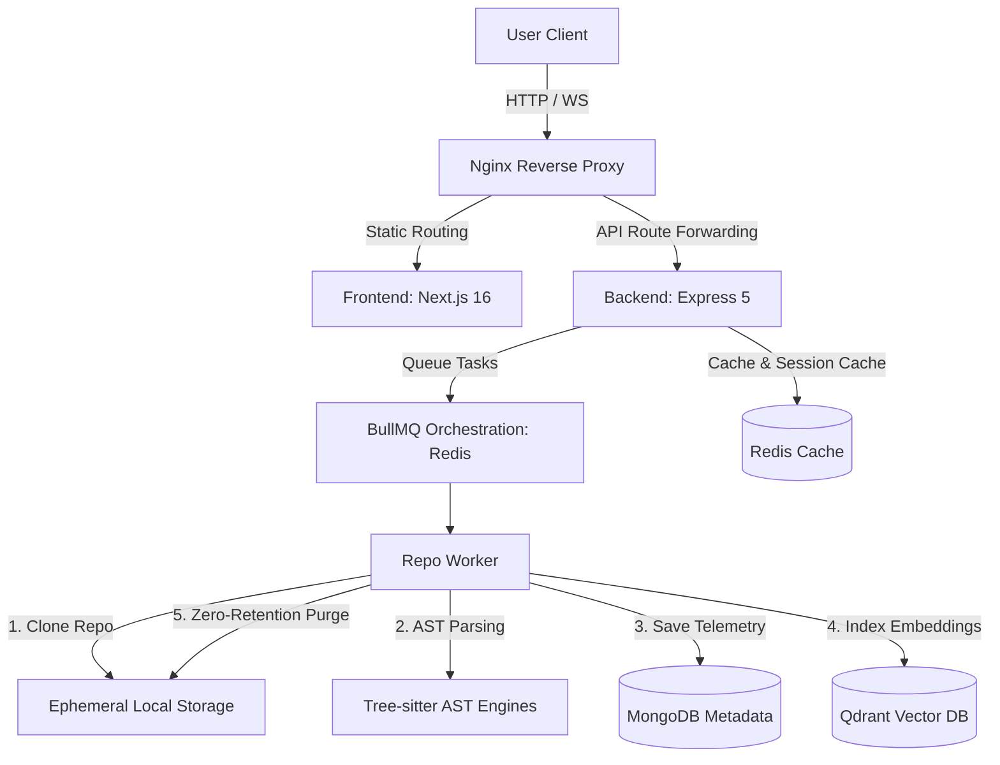

# RepoLens — AI-Powered Architectural Copilot & Full-Stack Analysis Engine


**Understand, analyze, and query your codebase. Faster than ever.**

RepoLens is an enterprise-grade AI-powered architectural copilot that leverages high-fidelity AST parsing, temporal vector embeddings, and Retrieval-Augmented Generation (RAG) to let you visually map, explore, and query any codebase through natural language. Stop reading thousands of lines of code—interrogate your repository directly and get exact, contextual explanations instantly.

> **Supported Languages:** JavaScript, TypeScript, Python, Go, Rust, Java, C, C++, C#, PHP, Ruby — parsed down to scope-aware abstract syntax trees using [Tree-sitter](https://tree-sitter.github.io/tree-sitter/) for precise dependency and scope resolution.

---

## 🌌 Core Spaces & Modules

The platform is structured into two main workspaces:

### 🖥️ RepoSpace
The interactive core workspace dashboard where you explore, map, and query repository structures visually and textually:
* **8 Layout Viz Modes:** Toggle between Force-directed graph, Visual relation node-link maps, Treemaps (LOC profiles), Adjacency Matrix (import coupling), Dendrograms, Sankey flows, Disjoint cluster hulls, and Circular edge bundling.
* **Integrated Monaco Editor:** Browse directory files via the sliding Tree Explorer and jump directly to coordinate-targeted code entities.
* **Context-Driven AI RAG Chat:** Drag-and-drop file nodes, folder paths, compliance violations, or patterns directly into the chat prompt to restrict context boundaries.
* **Impact Blast Radius Simulator:** Map direct and indirect downstream dependency paths to visualize ripple effects of code changes.
* **Architecture Compliance & Security Checks:** Verify layered import rules (Levels 1-5 validation) and flag hardcoded keys, SQLi, and XSS patterns.
* **Onboarding & Design Docs:** Automatically generate reading guides and Mermaid.js architecture flowcharts.
* **Voice-Powered exploration:** Query codebases using integrated AssemblyAI Speech-to-Text and Murf AI Text-to-Speech call services.

### 🧪 RepoLabs
The vector-powered advanced analytics suite running under the hood to perform deep mathematical codebase interrogation.
* **Semantic Search:** Find variables, features, and abstractions using plain-text queries instead of exact keyword/regex searches.
* **Version Drift Detector:** Computes Cosine vector distances across commits/versions to trace semantic logic churn.
* **Clone/Duplicate Finder:** Uncovers duplicate logic paths across files, clustering semantically identical blocks.

---

## 🚀 Key Features


### 🧠 Contextual AI Chat & Drag-and-Drop RAG
Ask natural language questions like *"Where is the database connection managed?"* or *"Walk me through the user registration lifecycle."* 
- **Autoritative RAG Engine:** Powered by Google Gemini with semantic vector search.
- **Drag-and-Drop Context:** Attach files, folders, code entities, security issues, or architectural compliance warnings directly from the UI to serve as the primary prompt context.
- **Hybrid Query Processing:** Falls back to vector search when no explicit context is provided.

### 🌐 Interactive 2D Force-Graph & CodeFlow Visualizer
Visualize your repository as an interconnected, scope-aware dependency graph.
- Maps connections between files, functions, variables, classes, and modules.
- Zoom, pan, and filter nodes by entity type.
- Click any node to open its implementation in the side-by-side Monaco editor.

### 💥 Blast Radius & Impact Analysis
Identify downstream ripple effects before making code modifications.
- **Analysis:** Resolves direct and indirect dependency trees.
- **Visual Mapping:** Highlights affected files, functions, and modules in red on the force-graph.
- **LLM Integration:** Ask the chatbot what will break if a file/function changes, and it automatically triggers the blast radius visualization using native tags.

### 🔍 Static Security Scan
In-depth static analysis parsing rules targeting common security threats:
- **Hardcoded Secrets:** Detects exposed passwords, API keys, and authorization tokens.
- **Injections:** Flag SQL injection patterns (string concatenation in queries) and XSS risks (`innerHTML`, `dangerouslySetInnerHTML`).
- **Dynamic execution:** Searches for `eval()`, dynamic Function constructors, and risky OS command executions.
- **Outstanding Comments:** Tracks TODOs, FIXMEs, HACKs, and XXX flags.

### 🛡️ Clean Architecture Compliance Checks
Validate codebase layering and enforce architectural integrity based on Clean Architecture boundaries.
- **Layer Mapping:** Levels 1 to 5 (Utils & Config -> Models & DB Schemas -> Services & Core Logic -> Controllers & Routes -> UI & Views).
- **Leak Detection:** Flags boundary violations where lower layers depend on or import from higher layers.

### 📈 Temporal Codebase Drift Detection
Track how code semantics change across different versions or entirely separate repositories.
- Uses Qdrant as a temporal vector database.
- Paginate points using `scroll` and compare vectors using query-matching to calculate drift scores.
- Summarizes modified, deleted, and new entities alongside an overall semantic drift score.

### 👥 Semantic Clone/Duplicate Detection
Locate duplicated or near-duplicate logic written across different files.
- Uses Qdrant's vector similarity matching rather than simple string comparisons.
- Identifies semantic clones that perform the same operations but use different naming or structure.
- Aggregates duplicate code into clusters sorted by average similarity.

### 📖 Onboarding Guide & System Design Diagrams
- **Mermaid.js Flowcharts:** Generates beautiful, logically-grouped system design diagrams on-demand.
- **Onboarding Guides:** Analyzes entry points, schemas, controllers, and tests to build a step-by-step reading path for new developers.

### 📞 Hands-Free Voice-Powered Exploration
- Stream text-to-speech with Murf AI.
- Transcribe audio speech using AssemblyAI.

---

## 🏗 System Architecture



### Key Architectural Decisions
- **Ephemeral Filesystem footprint:** Repositories are cloned to temporary space, parsed, embedded into Qdrant/MongoDB, and immediately purged to ensure zero file retention.
- **Asynchronous Task Processing:** BullMQ queues parsing tasks, giving immediate `202 Accepted` status responses to prevent connection timeouts during large repository clones.
- **Scoped AST Resolvers:** Tree-sitter provides deep syntax tree inspection across 11 languages, identifying functions, exports, imports, and relationships.
- **Temporal Vectors:** Qdrant collections maintain `repoId` and `fingerprint` payload fields to permit targeted semantic search, drift analysis, and clone queries.

---

## 🛠 Technology Stack

| Layer | Technologies & Tools |
|---|---|
| **Frontend** | Next.js 16 (App Router), React 19, Zustand, Tailwind CSS v4, Lucide Icons |
| **Interactive UI** | Monaco Editor (`@monaco-editor/react`), D3.js Force-Graph (`react-force-graph-2d`), react-resizable-panels, Mermaid.js |
| **Backend** | Node.js 22 (LTS), Express 5, TypeScript 5, Mongoose 9 |
| **Task Queue** | BullMQ + ioredis (High-throughput background job queue) |
| **AST Parsers** | Tree-sitter (C, C#, C++, Go, Java, JavaScript, PHP, Python, Ruby, Rust, TypeScript native compilers) |
| **Vector Engine** | Qdrant Vector DB (Dense similarity search and Cosine distance comparisons) |
| **AI/LLM** | Google Gemini (`gemini-2.5-flash`), Google GenAI Embeddings (`gemini-embedding-001`) |
| **Voice Engine** | AssemblyAI (Speech-to-Text), Murf AI (Text-to-Speech) |
| **Ingress & Proxy** | Nginx Reverse Proxy (Dynamic routing, rate-limiting, connection buffering) |
| **DevOps & Orchestration** | Docker, Docker Compose (Multi-container orchestration, automated health checks) |
| **Infrastructure & Storage** | MongoDB Community Server (Persistent metadata), Redis alpine (Session caches & Queue store) |
| **Dev Tools & Scripts** | `setup.sh` (Auto-dependency resolver), `Makefile` (Workflow task automation), `gcc`/`g++`/`make` (native compilers for tree-sitter bindings) |

---

## 📂 Codebase Layout

```
repolens/
├── docker-compose.yml           # Multi-container orchestration config
├── Makefile                     # Dev workflow shortcuts
├── setup.sh                     # System configuration & dependency setup script
│
├── backend/
│   ├── src/
│   │   ├── app.ts               # Express application initialization
│   │   ├── server.ts            # Entry point (connects DB, queues cleanup job)
│   │   ├── config/              # Passport & Database configurations
│   │   ├── controllers/         # REST API endpoints (Chat, graph, drift, clones, security)
│   │   ├── models/              # MongoDB Schemas (CodeEntity, Relationships, Repos, Violations)
│   │   ├── modules/
│   │   │   ├── indexer/         # File system scanner and entity indexers
│   │   │   └── parser/          # Language parsers and Tree-sitter mapping
│   │   ├── queue/               # BullMQ connection definitions
│   │   ├── workers/             # Async job workers (repoWorker, cleanupWorker)
│   │   ├── services/            # Core business logic (RAG, Qdrant, Security, Compliance)
│   │   ├── middlewares/         # Authorization, Error handler, LLM Rate Limiting
│   │   └── routes/              # Express API route maps
│   └── tsconfig.json            # Target NodeNext compile options
│
├── frontend/
│   ├── app/                     # Next.js App router views (dashboard, chat, graph, clones)
│   ├── components/              # Context panels, Monaco Editor wrapper, visualizers
│   ├── context/                 # React Editor states
│   └── package.json             # React 19 / Next.js 16 setup
│
└── nginx/
    └── nginx.conf               # Reverse proxy routing & rate limiting rules
```

---

## 🚀 Getting Started

### Prerequisites
- **Node.js v22 (LTS)**
- **Docker & Docker Compose**
- **Git**

### Local Quickstart

1. **Clone the project**
   ```bash
   git clone https://github.com/your-org/repolens.git
   cd repolens
   ```

2. **Initialize Environment**
   Execute the validation and setup script. This checks your Node version, installs native OS tools required by Tree-sitter compilers, runs `npm ci` for packages, and sets up a starter configuration:
   ```bash
   chmod +x setup.sh
   ./setup.sh
   ```

3. **Configure API Secrets**
   Open `backend/.env` and update the required credentials:
   ```env
   GOOGLE_API_KEY=your_gemini_api_key
   JWT_SECRET=use_a_strong_random_string_here
   ```

4. **Boot Infrastructure Services**
   Start the supporting databases (MongoDB, Redis, Qdrant) in the background:
   ```bash
   make dev
   ```

5. **Seed Sandbox Data (Optional)**
   Verify everything is working by seeding a test user and analyzing a sample local repository:
   ```bash
   cd backend && npm run seed
   ```

6. **Start Dev Servers**
   - **Backend (Terminal 1):**
     ```bash
     cd backend && npm run dev
     ```
   - **Frontend (Terminal 2):**
     ```bash
     cd frontend && npm run dev
     ```

7. **Access App**
   Open **http://localhost:3000/login** and click **"Dev Login"** to access the sandbox environment immediately.

---

## 🐳 Docker Deployment

To build and launch the production cluster (Frontend, Backend, MongoDB, Redis, Qdrant, and Nginx reverse proxy routing):

```bash
# Build and launch all services
make build

# View running container logs
make logs

# Restart the cluster
make restart

# Stop all services
make stop

# Tear down databases and purge volume storage
make clean

# Wipe all storage and delete local Qdrant vectors
make wipe
```

Once running, navigate to **http://localhost** (Port 80). Nginx handles routing and proxying to the underlying Next.js client and Express API containers.

---

## ⚙️ Environment Configuration

### Backend Secrets (`backend/.env`)

| Variable | Required | Description |
|---|---|---|
| `PORT` | Yes | App runtime port (defaults to `5000`) |
| `NODE_ENV` | Yes | Execution mode (`development` or `production`) |
| `MONGO_URI` | Yes | MongoDB connection URI |
| `REDIS_URL` | Yes | Redis cluster connection URI |
| `QDRANT_URL` | Yes | Qdrant vector database endpoint URL |
| `QDRANT_API_KEY`| No | Optional API key for Qdrant Cloud setups |
| `GOOGLE_API_KEY`| Yes | Google Gemini API credentials |
| `JWT_SECRET` | Yes | Token signature secret key |
| `GITHUB_CLIENT_ID`| Yes | GitHub OAuth Application Client ID |
| `GITHUB_CLIENT_SECRET`| Yes | GitHub OAuth Application Secret Key |
| `GITHUB_APP_ID` | No | Required to access private repositories |
| `GITHUB_APP_PRIVATE_KEY`| No | RSA private key credential for GitHub App |
| `MURF_API_KEY` | No | Text-To-Speech engine credential |
| `ASSEMBLYAI_API_KEY`| No | Speech-To-Transcription endpoint key |

---

## 🤝 Contributing

We welcome contributions! Please review the [CONTRIBUTING.md](CONTRIBUTING.md) guide to understand our coding standards, test coverage targets, and pulling process.

---

## 📄 License

RepoLens is licensed under the [ISC License](LICENSE).

---
*Built for developers who want to understand code, not just read it.*